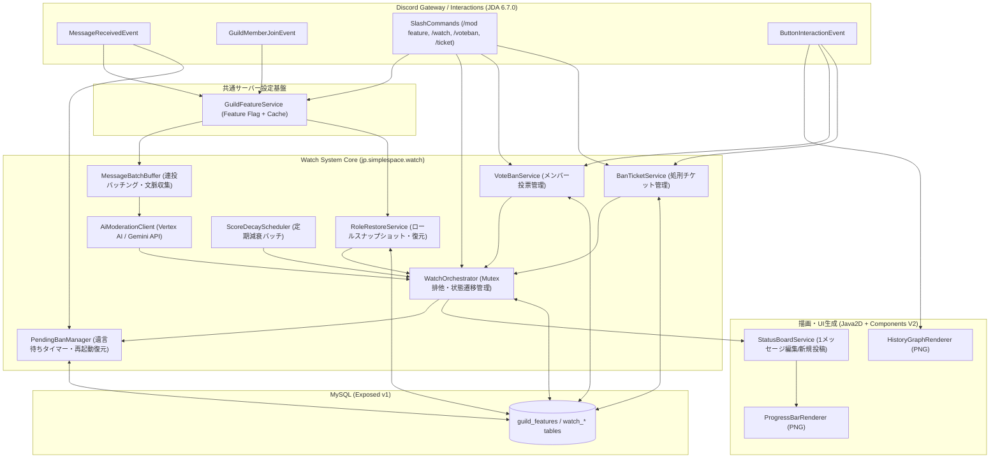
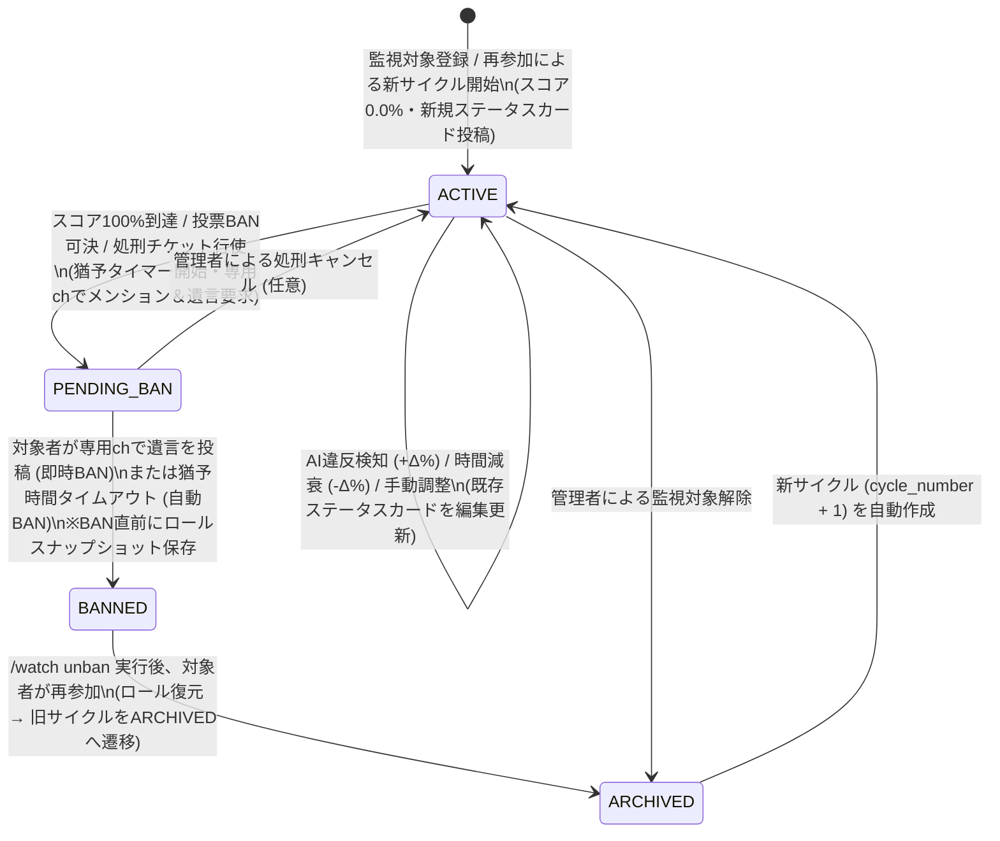
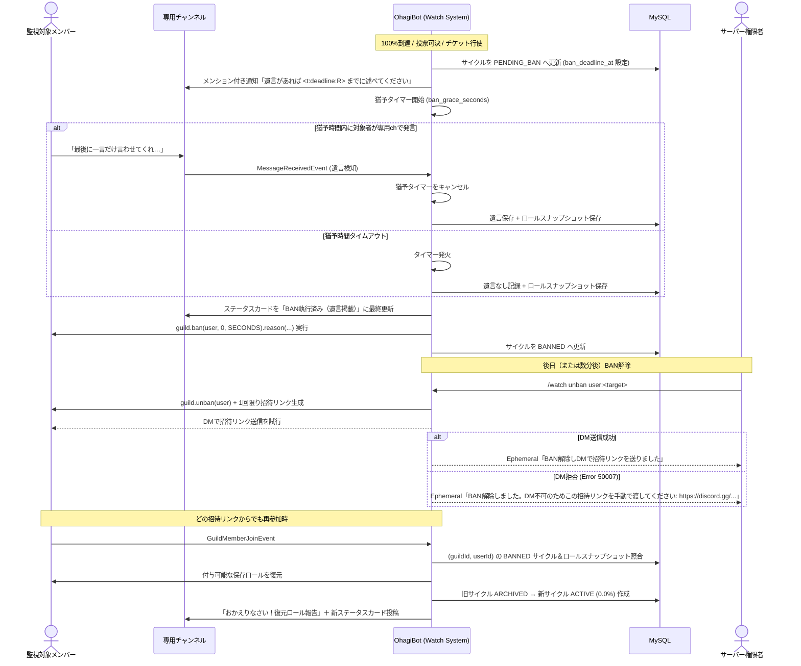

# メンバー監視・エンタメ処罰機能（Watch System）実装設計書

本ドキュメントは、Ohagi Discord Bot（Kotlin / Ktor / Exposed v1 / JDA 6.7.0 / MySQL）に新しく追加する「身内サーバー向け・監視対象メンバーの違反度可視化＆処罰システム（内部名称: **Watch System**）」の包括的な設計仕様です。次の実装フェーズや別のAIエージェントが、この設計書だけを参照して一貫した実装を行える粒度でまとめています。

---

## 1. 既存コードベースとの統合方針

現行プロジェクトの技術スタックと規約に完全準拠させます。

| 項目 | 現行構成 | 本機能での方針 |
| :--- | :--- | :--- |
| 言語 / JVM | Kotlin `2.4.21` / JVM `25`（Corretto 25） | そのまま踏襲 |
| Web / HTTP | Ktor Server & Client `3.6.1`（CIO + kotlinx.serialization） | AI 呼び出しは公式 Google Gen AI Java SDK (`com.google.genai:google-genai`) を採用（Vertex AI / Gemini API 統一クライアント） |
| Discord | JDA `6.7.0` + `jda-ktx 0.15.0` + `jda-chewtils 2.2.1` | 既存の `SlashCommand` / `ModCommand` / **Components V2**（`Container`, `TextDisplay`, `MediaGallery`, `ActionRow`, `useComponentsV2()`）を採用 |
| Gateway Intents | `GatewayIntent.entries` 全有効 / `MemberCachePolicy.ALL` | `MessageReceivedEvent`・`GuildMemberJoinEvent`・ロール参照がそのまま利用可能 |
| DB / ORM | MySQL + Exposed v1 (`1.6.1`) | `jp.simplespace.db` にスキーマ＋サービスを追加し、`Databases.kt` で初期化・テーブル自動作成（`SchemaUtils.create`）。日時は **UTC Epoch Milliseconds (`long`)** で統一 |
| 非同期処理 | `OhagiBot.scope` (`SupervisorJob() + Dispatchers.IO`) | 監視イベント処理・AI呼び出し・猶予タイマー・減衰スケジューラをコルーチンで実装 |
| オーナー権限 | `ModCommand` (`ownerCommand = true`) | Feature Flag管理を `/mod feature ...` として追加 |

### 既存ファイルへの主な変更・接続ポイント
- [Databases.kt](file:///c:/Users/Matchan/IdeaProjects/Ohagi/src/main/kotlin/Databases.kt): 新規DBサービス群の初期化と公開
- [OhagiBot.kt](file:///c:/Users/Matchan/IdeaProjects/Ohagi/src/main/kotlin/discord/OhagiBot.kt): 新規スラッシュコマンド・イベントリスナー登録、`ReadyEvent` でのタイマー復元・定期ジョブ起動
- [ModCommand.kt](file:///c:/Users/Matchan/IdeaProjects/Ohagi/src/main/kotlin/discord/commands/mod/ModCommand.kt): `FeatureMod` サブコマンド追加
- [ActionListener.kt](file:///c:/Users/Matchan/IdeaProjects/Ohagi/src/main/kotlin/discord/listeners/ActionListener.kt): 変更せず、本機能用の専用リスナー（`WatchEventListener`, `WatchInteractionListener`）を分離追加して責務を疎結合に保つ
- [build.gradle.kts](file:///c:/Users/Matchan/IdeaProjects/Ohagi/build.gradle.kts): 必要最小限の依存追加（GCP認証ライブラリ等）
- [Dockerfile](file:///c:/Users/Matchan/IdeaProjects/Ohagi/Dockerfile): 日本語フォントをリソース同梱する方式により追加のOSパッケージ不要

---

## 2. システム全体アーキテクチャと状態遷移

### 2.1 コンポーネント構成



### 2.2 監視サイクルの状態遷移

1人の監視対象ユーザーは、監視開始からBAN・再参加までを **1サイクル（`watch_cycles`）** として管理します。



> [!IMPORTANT]
> **排他制御の原則**: 同一の `(guildId, targetUserId)` に対して「AIによる100%到達」「投票可決」「チケット行使」「時間減衰」「遺言受信」が同時発生する可能性があるため、`WatchOrchestrator` 内に `ConcurrentHashMap<String, Mutex>`（キー: `"$guildId:$userId"`）を持ち、状態遷移・スコア更新・ステータスカード編集を直列化します。

### 2.3 パッケージ構成案

```text
src/main/kotlin/jp/simplespace/
├── db/
│   ├── GuildFeatureSchema.kt        # 汎用Feature Flag & サーバー共通設定
│   ├── WatchConfigSchema.kt         # 監視機能のサーバー単位設定・監視対象
│   ├── WatchCycleSchema.kt          # サイクル・スコア履歴・ロールスナップショット
│   ├── WatchVoteTicketSchema.kt     # 投票BAN・処刑チケット
│   └── WatchAiSchema.kt             # AIカスタムルール・フィードバック事例
├── ai/
│   ├── AiModerationClient.kt        # 抽象インターフェース + 構造化レスポンスDTO
│   ├── GeminiModerationClient.kt    # Vertex AI / Gemini API 実装
│   └── ModerationPromptBuilder.kt   # ルール・Few-shot・会話文脈のプロンプト組み立て
├── watch/
│   ├── WatchOrchestrator.kt         # 状態遷移・スコア計算・BAN実行の中核
│   ├── MessageBatchBuffer.kt        # 連投バッチング・会話コンテキスト収集
│   ├── PendingBanManager.kt         # 遺言待ちタイマー・起動時復元
│   ├── RoleRestoreService.kt        # ロール保存・再参加時復元・招待リンク送信
│   ├── VoteBanService.kt            # メンバー投票ロジック・締切タイマー
│   ├── BanTicketService.kt          # 処刑チケット発行/承認/行使
│   ├── ScoreDecayScheduler.kt       # 定期減衰・落ち着きボーナス計算
│   ├── StatusBoardService.kt        # 専用chのプログレスバーメッセージ管理
│   └── render/
│       ├── FontLoader.kt            # 同梱日本語フォントのロード
│       ├── ColorGradient.kt         # 0%〜100%の色補間ユーティリティ
│       ├── ProgressBarRenderer.kt   # プログレスバーPNG描画 (Java2D)
│       └── HistoryGraphRenderer.kt  # 推移グラフPNG描画 (Java2D)
└── discord/
    ├── commands/
    │   ├── mod/
    │   │   └── FeatureMod.kt        # /mod feature enable|disable|list
    │   └── watch/
    │       ├── WatchCommand.kt      # /watch ... (管理者向け監視・設定・AI・BAN解除)
    │       ├── VoteBanCommand.kt    # /voteban ... (メンバー投票BAN)
    │       └── TicketCommand.kt     # /ticket ... (処刑チケット)
    └── listeners/
        ├── WatchEventListener.kt    # MessageReceived / GuildMemberJoin
        └── WatchInteractionListener.kt # ボタン・確認ダイアログ処理
```

---

## 3. 汎用サーバー設定・Feature Flag 基盤

今後ほかのサーバー限定機能にも流用できるよう、Feature Flag管理をWatch Systemから独立した共通モジュールとして設計します。

### 3.1 Feature Key 定義

```kotlin
enum class FeatureKey(val key: String, val displayName: String, val description: String) {
    WATCH_SYSTEM("watch_system", "メンバー監視・処罰システム", "監視対象の違反度可視化・AI判定・遺言BAN機能"),
}
```

### 3.2 動作仕様
- **デフォルト無効**: レコードが存在しないサーバーでは `enabled = false` とみなす。
- **キャッシュ**: `ConcurrentHashMap<Pair<String, String>, Boolean>` でインメモリキャッシュし、`MessageReceivedEvent` ごとのDB参照を避ける。更新時にキャッシュを即時反映する。
- **操作権限**: ボットオーナーのみ（既存の `ModCommand` 配下に `ownerCommand = true` として追加）。
- **コマンド仕様**:
  - `/mod feature enable feature:<FeatureKey> [guild_id:<ID>]`（`guild_id` 省略時は実行サーバー）
  - `/mod feature disable feature:<FeatureKey> [guild_id:<ID>]`
  - `/mod feature list [guild_id:<ID>]`（指定サーバーの有効機能一覧、または機能ごとの有効サーバー一覧）

---

## 4. データベース設計（MySQL / Exposed v1）

すべてのテーブルは `SchemaUtils.create(...)` で起動時自動作成します。文字コードは絵文字・日本語を含むため MySQL 側で `utf8mb4` を前提とします。

### 4.1 汎用 Feature Flag テーブル

#### `guild_features`
| カラム名 | 型 | 制約 | 説明 |
| :--- | :--- | :--- | :--- |
| `guild_id` | `VARCHAR(64)` | PK | Discord サーバーID |
| `feature_key` | `VARCHAR(64)` | PK | FeatureKey（例: `watch_system`） |
| `enabled` | `BOOLEAN` | NOT NULL, DEFAULT FALSE | 有効フラグ |
| `updated_by` | `VARCHAR(64)` | NOT NULL | 最終変更ユーザーID |
| `updated_at` | `BIGINT` | NOT NULL | 更新日時 (UTC epoch ms) |

### 4.2 監視設定・監視対象テーブル

#### `watch_guild_configs`（サーバー単位の監視設定）
| カラム名 | 型 | 制約 | 説明 |
| :--- | :--- | :--- | :--- |
| `guild_id` | `VARCHAR(64)` | PK | Discord サーバーID |
| `default_channel_id` | `VARCHAR(64)` | NULL | デフォルト専用チャンネルID |
| `approval_channel_id` | `VARCHAR(64)` | NULL | AIチケット提案・管理者通知用チャンネルID（NULL時は `default_channel_id`） |
| `manager_role_id` | `VARCHAR(64)` | NULL | 監視管理者ロールID（NULL時は `BAN_MEMBERS` 権限者のみ） |
| `ban_grace_seconds` | `INT` | NOT NULL, DEFAULT 60 | 100%到達〜BANまでの遺言猶予時間（秒） |
| `ai_enabled` | `BOOLEAN` | NOT NULL, DEFAULT TRUE | AI自動判定の有効/無効 |
| `ai_sensitivity` | `DOUBLE` | NOT NULL, DEFAULT 1.0 | 違反スコア倍率（`0.2`〜`3.0`） |
| `ai_max_delta_per_eval` | `DOUBLE` | NOT NULL, DEFAULT 25.0 | 1評価あたりの最大加算上限（%） |
| `ai_auto_ticket_mode` | `VARCHAR(16)` | NOT NULL, DEFAULT `'APPROVAL'` | `OFF` / `APPROVAL`（管理者承認）/ `AUTO`（自動発行） |
| `excluded_channel_ids_json` | `TEXT` | NOT NULL, DEFAULT `'[]'` | AI監視除外チャンネルID配列（JSON） |
| `decay_enabled` | `BOOLEAN` | NOT NULL, DEFAULT TRUE | 時間減衰の有効/無効 |
| `decay_grace_hours` | `INT` | NOT NULL, DEFAULT 24 | 最終違反から減衰開始までの無違反時間 |
| `decay_interval_hours` | `INT` | NOT NULL, DEFAULT 6 | 減衰を実行する間隔（時間） |
| `decay_amount` | `DOUBLE` | NOT NULL, DEFAULT 2.0 | 1回あたりの基本減衰量（%） |
| `decay_calm_bonus_multiplier` | `DOUBLE` | NOT NULL, DEFAULT 1.5 | 前期間比で落ち着いているときの減衰倍率 |
| `vote_enabled` | `BOOLEAN` | NOT NULL, DEFAULT TRUE | メンバー投票BANの有効/無効 |
| `vote_duration_minutes` | `INT` | NOT NULL, DEFAULT 15 | 投票受付時間（分） |
| `vote_min_yes_votes` | `INT` | NOT NULL, DEFAULT 3 | 可決に必要な最低賛成票数 |
| `vote_pass_ratio` | `DOUBLE` | NOT NULL, DEFAULT 0.6 | 可決に必要な賛成率（0.0〜1.0） |
| `vote_cooldown_minutes` | `INT` | NOT NULL, DEFAULT 360 | 否決後の同一対象への再発議クールダウン（分） |
| `vote_use_last_words` | `BOOLEAN` | NOT NULL, DEFAULT TRUE | 投票可決時に遺言フェーズを挟むか |
| `ticket_use_last_words` | `BOOLEAN` | NOT NULL, DEFAULT TRUE | チケット行使時に遺言フェーズを挟むか |
| `updated_at` | `BIGINT` | NOT NULL | 最終更新日時 |

#### `watch_targets`（監視対象ユーザー）
| カラム名 | 型 | 制約 | 説明 |
| :--- | :--- | :--- | :--- |
| `id` | `BIGINT` | PK, AUTO_INCREMENT | 内部ターゲットID |
| `guild_id` | `VARCHAR(64)` | NOT NULL, UK(`guild_id`, `user_id`) | サーバーID |
| `user_id` | `VARCHAR(64)` | NOT NULL | 監視対象ユーザーID |
| `dedicated_channel_id` | `VARCHAR(64)` | NULL | 個別専用チャンネルID（NULLなら `watch_guild_configs.default_channel_id` を使用） |
| `persona_note` | `TEXT` | NULL | 対象者の特徴メモ（AIプロンプトの参考情報） |
| `active` | `BOOLEAN` | NOT NULL, DEFAULT TRUE | 現在監視中か（論理削除で過去履歴を保持） |
| `current_cycle_id` | `BIGINT` | NULL | 現在のサイクルID |
| `created_by` | `VARCHAR(64)` | NOT NULL | 登録した管理者ID |
| `created_at` | `BIGINT` | NOT NULL | 登録日時 |

### 4.3 サイクル・スコア履歴・ロール復元テーブル

#### `watch_cycles`（監視サイクル）
| カラム名 | 型 | 制約 | 説明 |
| :--- | :--- | :--- | :--- |
| `id` | `BIGINT` | PK, AUTO_INCREMENT | サイクルID |
| `target_id` | `BIGINT` | NOT NULL, INDEX | `watch_targets.id` |
| `guild_id` | `VARCHAR(64)` | NOT NULL, INDEX(`guild_id`, `user_id`, `status`) | サーバーID |
| `user_id` | `VARCHAR(64)` | NOT NULL | 対象ユーザーID |
| `cycle_number` | `INT` | NOT NULL | 通算何回目のサイクルか（1, 2, 3...） |
| `status` | `VARCHAR(16)` | NOT NULL | `ACTIVE` / `PENDING_BAN` / `BANNED` / `ARCHIVED` |
| `current_score` | `DOUBLE` | NOT NULL, DEFAULT 0.0 | 現在違反度（`0.0`〜`100.0`） |
| `status_channel_id` | `VARCHAR(64)` | NULL | ステータスカードが存在するチャンネルID |
| `status_message_id` | `VARCHAR(64)` | NULL | ステータスカードのメッセージID（編集対象） |
| `ban_trigger_type` | `VARCHAR(16)` | NULL | `SCORE_100` / `VOTE` / `TICKET` |
| `ban_trigger_detail` | `TEXT` | NULL | BAN契機の詳細（投票ID・チケット発行者など） |
| `ban_deadline_at` | `BIGINT` | NULL | 遺言猶予の締切日時（`PENDING_BAN` 時に設定） |
| `last_words_content` | `TEXT` | NULL | 対象者が残した遺言テキスト |
| `last_words_message_id` | `VARCHAR(64)` | NULL | 遺言メッセージID |
| `last_violation_at` | `BIGINT` | NULL | 最終違反加算日時（減衰の起算点） |
| `last_decay_at` | `BIGINT` | NULL | 最終減衰実行日時 |
| `started_at` | `BIGINT` | NOT NULL | サイクル開始日時 |
| `banned_at` | `BIGINT` | NULL | BAN実行日時 |
| `unbanned_at` | `BIGINT` | NULL | BAN解除実行日時 |
| `rejoined_at` | `BIGINT` | NULL | 再参加日時 |

#### `watch_score_events`（違反度変動履歴＝グラフ描画ソース）
| カラム名 | 型 | 制約 | 説明 |
| :--- | :--- | :--- | :--- |
| `id` | `BIGINT` | PK, AUTO_INCREMENT | イベントID |
| `cycle_id` | `BIGINT` | NOT NULL, INDEX | `watch_cycles.id` |
| `target_id` | `BIGINT` | NOT NULL, INDEX(`target_id`, `created_at`) | `watch_targets.id`（累計グラフ高速取得用） |
| `guild_id` | `VARCHAR(64)` | NOT NULL | サーバーID |
| `user_id` | `VARCHAR(64)` | NOT NULL | 対象ユーザーID |
| `event_type` | `VARCHAR(24)` | NOT NULL | `CYCLE_START` / `AI_VIOLATION` / `DECAY` / `MANUAL_ADJUST` / `VOTE_BAN` / `TICKET_BAN` / `BANNED` |
| `delta` | `DOUBLE` | NOT NULL | 増減値（例: `+8.5`, `-2.0`, `0.0`） |
| `score_after` | `DOUBLE` | NOT NULL | 変動後の現在違反度（`0.0`〜`100.0`） |
| `category` | `VARCHAR(32)` | NULL | 違反カテゴリ（`INSULT`, `TOXIC`, `SPAM`, `HARASSMENT`, `DECAY` 等） |
| `reason` | `TEXT` | NULL | 表示用の理由（日本語） |
| `source_channel_id` | `VARCHAR(64)` | NULL | 発言チャンネルID |
| `source_message_id` | `VARCHAR(64)` | NULL | 発言メッセージID |
| `source_message_excerpt` | `TEXT` | NULL | 判定対象の発言抜粋（最大500文字） |
| `ai_raw_json` | `TEXT` | NULL | AI生レスポンス（監査・チューニング用） |
| `actor_user_id` | `VARCHAR(64)` | NULL | 手動調整者・投票発議者・チケット行使者など |
| `created_at` | `BIGINT` | NOT NULL | 記録日時 |

#### `watch_role_snapshots`（BAN直前のロール退避）
| カラム名 | 型 | 制約 | 説明 |
| :--- | :--- | :--- | :--- |
| `id` | `BIGINT` | PK, AUTO_INCREMENT | スナップショットID |
| `cycle_id` | `BIGINT` | NOT NULL, UK | `watch_cycles.id` |
| `guild_id` | `VARCHAR(64)` | NOT NULL | サーバーID |
| `user_id` | `VARCHAR(64)` | NOT NULL | 対象ユーザーID |
| `role_ids_json` | `TEXT` | NOT NULL | 保存ロール一覧 JSON `[{"id":"...","name":"..."}]` |
| `nickname` | `VARCHAR(64)` | NULL | BAN前のサーバーニックネーム |
| `captured_at` | `BIGINT` | NOT NULL | 取得日時 |
| `restored_at` | `BIGINT` | NULL | 復元完了日時 |

### 4.4 投票BAN・処刑チケットテーブル

#### `watch_votes`
| カラム名 | 型 | 制約 | 説明 |
| :--- | :--- | :--- | :--- |
| `id` | `BIGINT` | PK, AUTO_INCREMENT | 投票ID |
| `guild_id` | `VARCHAR(64)` | NOT NULL, INDEX | サーバーID |
| `target_id` | `BIGINT` | NOT NULL, INDEX | `watch_targets.id` |
| `cycle_id` | `BIGINT` | NOT NULL | 対象サイクルID |
| `initiator_user_id` | `VARCHAR(64)` | NOT NULL | 発議者ユーザーID |
| `reason` | `TEXT` | NOT NULL | 発議理由 |
| `channel_id` | `VARCHAR(64)` | NOT NULL | 投票メッセージのチャンネルID |
| `message_id` | `VARCHAR(64)` | NULL | 投票メッセージID |
| `status` | `VARCHAR(16)` | NOT NULL | `OPEN` / `PASSED` / `REJECTED` / `CANCELLED` |
| `expires_at` | `BIGINT` | NOT NULL | 投票締切日時 |
| `created_at` | `BIGINT` | NOT NULL | 開始日時 |
| `closed_at` | `BIGINT` | NULL | 確定日時 |

#### `watch_vote_ballots`
| カラム名 | 型 | 制約 | 説明 |
| :--- | :--- | :--- | :--- |
| `vote_id` | `BIGINT` | PK | `watch_votes.id` |
| `voter_user_id` | `VARCHAR(64)` | PK | 投票者ユーザーID |
| `choice` | `VARCHAR(8)` | NOT NULL | `YES` / `NO` |
| `voted_at` | `BIGINT` | NOT NULL | 投票日時 |

#### `watch_ban_tickets`
| カラム名 | 型 | 制約 | 説明 |
| :--- | :--- | :--- | :--- |
| `id` | `BIGINT` | PK, AUTO_INCREMENT | チケットID |
| `guild_id` | `VARCHAR(64)` | NOT NULL, INDEX | サーバーID |
| `target_id` | `BIGINT` | NOT NULL, INDEX | 処刑対象の `watch_targets.id` |
| `holder_user_id` | `VARCHAR(64)` | NOT NULL, INDEX | 保有者（被害者）ユーザーID |
| `issued_by_user_id` | `VARCHAR(64)` | NULL | 発行した管理者ID（AI自動発行時はNULL） |
| `issue_source` | `VARCHAR(16)` | NOT NULL | `MANUAL` / `AI_APPROVED` / `AI_AUTO` |
| `reason` | `TEXT` | NOT NULL | 発行理由 |
| `source_score_event_id` | `BIGINT` | NULL | AI検知元の `watch_score_events.id` |
| `status` | `VARCHAR(24)` | NOT NULL | `PENDING_APPROVAL` / `ACTIVE` / `USED` / `REVOKED` / `EXPIRED` |
| `expires_at` | `BIGINT` | NULL | 有効期限（NULLで無期限） |
| `used_cycle_id` | `BIGINT` | NULL | 行使されたサイクルID |
| `created_at` | `BIGINT` | NOT NULL | 作成日時 |
| `used_at` | `BIGINT` | NULL | 行使日時 |

### 4.5 AIチューニング用テーブル

#### `watch_ai_rules`
| カラム名 | 型 | 制約 | 説明 |
| :--- | :--- | :--- | :--- |
| `id` | `BIGINT` | PK, AUTO_INCREMENT | ルールID |
| `guild_id` | `VARCHAR(64)` | NOT NULL, INDEX | サーバーID |
| `target_id` | `BIGINT` | NULL | NULLならサーバー共通ルール、指定あれば特定対象者専用ルール |
| `rule_type` | `VARCHAR(16)` | NOT NULL | `VIOLATION`（NG傾向） / `ALLOW`（許容・身内ネタ） |
| `description` | `TEXT` | NOT NULL | ルールの自然言語説明（例: 「『◯◯しろ』の暴言は重め」「『草』『雑魚ｗ』程度のゲーム煽りは許容」） |
| `weight_hint` | `VARCHAR(16)` | NOT NULL, DEFAULT `'MEDIUM'` | `LOW` / `MEDIUM` / `HIGH`（`VIOLATION` 時の重み目安） |
| `created_by` | `VARCHAR(64)` | NOT NULL | 作成者ID |
| `created_at` | `BIGINT` | NOT NULL | 作成日時 |

#### `watch_ai_feedbacks`（Few-shot学習用フィードバック）
| カラム名 | 型 | 制約 | 説明 |
| :--- | :--- | :--- | :--- |
| `id` | `BIGINT` | PK, AUTO_INCREMENT | フィードバックID |
| `guild_id` | `VARCHAR(64)` | NOT NULL, INDEX | サーバーID |
| `target_id` | `BIGINT` | NULL | 対象ID（NULLならサーバー全体で参照） |
| `score_event_id` | `BIGINT` | NULL | 関連する判定イベントID |
| `message_content` | `TEXT` | NOT NULL | 評価対象だった発言 |
| `context_excerpt` | `TEXT` | NULL | 前後の会話文脈 |
| `original_delta` | `DOUBLE` | NOT NULL | AIが付けた元スコア |
| `expected_delta` | `DOUBLE` | NOT NULL | 修正後の望ましいスコア（`0.0`〜`25.0`） |
| `verdict` | `VARCHAR(24)` | NOT NULL | `CORRECT` / `FALSE_POSITIVE` / `UNDERESTIMATED` / `MISSED` |
| `note` | `TEXT` | NULL | 「これは身内ネタなのでセーフ」等の補足説明 |
| `reviewer_user_id` | `VARCHAR(64)` | NOT NULL | レビューした管理者ID |
| `created_at` | `BIGINT` | NOT NULL | 登録日時 |

---

## 5. 専用チャンネル・プログレスバー・グラフ UI 設計

既存の [CalendarInfoGenerator.kt](file:///c:/Users/Matchan/IdeaProjects/Ohagi/src/main/kotlin/calendar/CalendarInfoGenerator.kt) と同じ **Discord Components V2**（`Container`, `TextDisplay`, `Separator`, `MediaGallery`, `ActionRow`）を全面採用します。

### 5.1 チャンネル割り当てとメッセージのライフサイクル
- **共有チャンネル / 個別チャンネル両対応**:
  - 対象メンバーごとの送信先は `target.dedicatedChannelId ?: guildConfig.defaultChannelId` で解決します。
  - 複数人を同じチャンネルに置けば各対象につき1メッセージずつ並び、個別チャンネルを指定すれば1人1チャンネルで運用できます。
- **1サイクル＝1メッセージ編集**:
  - `ACTIVE` 状態のスコア変動（違反加算・時間減衰・手動調整）時は、DBに保存された `(statusChannelId, statusMessageId)` のメッセージを **`editMessageComponents(...).setFiles(FileUpload.fromData(...)).useComponentsV2()`** で更新します。
  - もし手動削除等でメッセージが見つからない（`ErrorResponse.UNKNOWN_MESSAGE`）場合は、新規投稿して `statusMessageId` を更新します。
- **BAN・再参加時の新メッセージ作成**:
  - `PENDING_BAN` → `BANNED` 確定時、旧サイクルのステータスカードを「**BAN執行済み（遺言・BAN日時・契機を記載）**」に最終更新して凍結します（グラフボタンのみ残し、いつでも振り返れるようにします）。
  - 対象メンバーが再参加して新サイクル（`cycle_number + 1`）が始まると、**既存の旧メッセージは編集せず、チャンネル最下部に新しいステータスカードメッセージを投稿**します。これにより遺言や過去サイクルの記録がチャンネル履歴として綺麗に残ります。

### 5.2 プログレスバーの視覚設計と色変化仕様

違反度 `score`（`0.0`〜`100.0`）に応じて、**Components V2 `Container` の `accentColor`** と **動的生成するPNGプログレスバー画像** の両方を連続グラデーションで変化させます。

#### 色補間テーブル（線形RGB補間）
| 違反度 | カラーコード | 状態ラベル |
| :--- | :--- | :--- |
| `0%` | `#2ECC71`（緑） | 🟢 良好 / 落ち着いています |
| `40%` | `#F1C40F`（黄） | 🟡 注意 / やや不穏 |
| `70%` | `#E67E22`（橙） | 🟠 警戒 / 危険水域 |
| `90%` | `#E74C3C`（赤） | 🔴 危険 / BAN寸前 |
| `100%` | `#8B0000`（深紅） | 💀 処刑執行中 / BAN |

#### プログレスバー PNG 画像仕様（`ProgressBarRenderer`）
- **サイズ**: `800 × 180 px`（Discordダーク背景 `#2B2D31` 馴染みの角丸カード）
- **描画要素**:
  - 左上: 対象ユーザー名・サイクル番号（例: `Cycle #3`）
  - 右上: 大きく強調された現在パーセンテージ（例: `78.5%`）
  - 中央: 角丸プログレスバー（背景トラック `#1E1F22`、前景バーは現在スコアに応じたグラデーション塗り、25% / 50% / 75% 目盛り線）
  - 下部: 前回比差分（例: `+6.0% (直近: 不適切な煽り発言)`）または減衰カウントダウン情報
- **日本語フォント対策（重要）**:
  - `Dockerfile` の実行イメージ `amazoncorretto:25.0.3` には日本語フォントが入っていません。
  - `src/main/resources/fonts/NotoSansJP-Regular.ttf` および `NotoSansJP-Bold.ttf` をリポジトリに同梱し、`FontLoader` が `Font.createFont(Font.TRUETYPE_FONT, stream)` で読み込むことで、環境依存ゼロ・文字化けゼロを保証します。
  - 静的初期化で `System.setProperty("java.awt.headless", "true")` を設定します。

#### ステータスカード（Components V2）レイアウト例
```text
Container (accentColor = interpolatedColor(score))
├── TextDisplay: "## 🛡️ 監視ステータス: @T氏（第3サイクル）\n状態: 🟠 警戒 | 現在違反度: **78.5%** | 通算BAN: 2回"
├── MediaGallery: [ attachment://progress_bar.png ]
├── TextDisplay: "直近の変動: `+6.0%` — 暴言・煽り発言 (<t:1764000000:R>)\n-# 減衰予定: 無違反が24時間続くと開始"
├── Separator (SMALL)
└── ActionRow:
    ├── Button.primary("watch_graph:{targetId}:7d", "📊 グラフを見る")
    └── Button.secondary("watch_logs:{targetId}:0", "📋 違反ログ")
```

### 5.3 グラフ表示（Ephemeral一時メッセージ＋期間切替）

1. ユーザーがステータスカードの `📊 グラフを見る`（`watch_graph:{targetId}:7d`）をクリック。
2. `WatchInteractionListener` が `event.deferReply(true)`（**Ephemeral＝本人にのみ見える一時メッセージ**）で応答開始。
3. デフォルト期間 **過去1週間（`7d`）** の `watch_score_events` を取得し、`HistoryGraphRenderer` で `900 × 450 px` のPNGグラフを生成。
4. 以下の期間切替ボタン付きで返信：
   - `1日` (`watch_graph_range:{targetId}:1d`)
   - `1週間` (`watch_graph_range:{targetId}:7d`) ※選択中は `Button.primary` ＋ `disabled`
   - `1ヶ月` (`watch_graph_range:{targetId}:30d`)
   - `累計` (`watch_graph_range:{targetId}:all`)
5. 一時メッセージ上の期間切替ボタンが押されたら、`event.deferEdit()` で**同じ一時メッセージの画像とボタン状態を編集・差し替え**ます。

#### グラフ描画仕様（`HistoryGraphRenderer`）
- **Y軸**: `0%`〜`100%` 固定（`100%` ラインを赤破線で強調）
- **X軸**: 期間に応じた自動目盛り（`1d`: 2時間刻み `HH:mm`、`7d`: 1日刻み `MM/dd`、`30d`: 5日刻み `MM/dd`、`all`: 期間自動調整 `yyyy/MM/dd`）
- **データ補間**:
  - 期間開始時点の直前イベントから初期値を引き継ぎ、期間終了（現在時刻）までステップまたは折れ線で描画。
  - データ点が存在しない場合は「この期間の変動履歴はありません」と現在スコアの水平線を描画。
- **マーカー表現**:
  - 違反加算点: 赤/橙のドット
  - 時間減衰点: 緑のドット
  - BAN発生時点（`event_type == BANNED`）: 縦の赤破線＋`BAN` ラベル（直後に新サイクルで `0%` へリセットされる様子が明確に見える）
- **付帯テキストサマリー**:
  - 期間内の「違反検知回数」「最大違反度」「BAN回数」「減衰による回復合計」を `TextDisplay` に併記。

---

## 6. 処罰・遺言・BAN解除・再招待・ロール復元フロー

### 6.1 全体シーケンス



### 6.2 遺言フェーズ（`PendingBanManager`）の厳密な仕様
- **突入条件**:
  - 違反度が `100.0%` に到達（`ban_trigger_type = SCORE_100`）
  - 投票BANが可決かつ `vote_use_last_words = true`（`ban_trigger_type = VOTE`）
  - 処刑チケットが行使かつ `ticket_use_last_words = true`（`ban_trigger_type = TICKET`）
- **専用チャンネルへの通知**:
  - 対象メンバーへのメンション（`<@userId>`）を有効にしてメッセージを送信（`setAllowedMentions(listOf(MentionType.USER))`）。
  - 猶予時間のカウントダウンをDiscordタイムスタンプ `<t:${deadlineEpochSec}:R>` で表示。
- **遺言の判定条件**:
  - 対象サイクルが `PENDING_BAN` である
  - 発言チャンネルが対象者の専用チャンネル（`cycle.statusChannelId`）である
  - 発言者が対象ユーザー本人である
  - テキスト内容が空でない、または添付ファイル/スタンプがある（添付のみの場合は `[添付ファイル]` 等で記録）
  - 遺言メッセージ受信後、**即座に猶予タイマーをキャンセルしてBAN処理を実行**する。
- **猶予時間 = `0` 秒設定の場合**:
  - 遺言フェーズをスキップして即座にBANを実行する。
- **Bot再起動時の復元**:
  - `ReadyEvent` にて DB から `status == PENDING_BAN` の全レコードを取得。
  - `ban_deadline_at <= now` なら即時BANを実行、未来なら残りミリ秒でコルーチンタイマーを再スケジュールする。

### 6.3 BAN解除・再招待・ロール復元（`RoleRestoreService`）の厳密な仕様
- **BAN直前のロール保存**:
  - BAN実行直前に `guild.getMemberById(userId)`（キャッシュになければ `retrieveMemberById`）を取得。
  - `member.roles` から以下を除外して JSON 配列として `watch_role_snapshots` に保存：
    - `role.isPublicRole`（`@everyone`）
    - `role.isManaged`（Bot管理ロール・サーバーブースターロール等、手動付与できないロール）
  - 同時に `member.nickname` も保存する。
- **BAN実行時のメッセージ削除期間**:
  - 遺言や過去の発言を残すため、`guild.ban(UserSnowflake.fromId(userId), 0, TimeUnit.SECONDS)`（メッセージ削除日数 **0日**）でBANする。
- **BAN解除＆再招待コマンド**:
  - `/watch unban user:<ユーザーIDまたはメンション>`（BAN済みユーザー向けに `BANNED` 状態の監視対象から Autocomplete で選択可能にする）
  - 処理手順：
    1. `guild.unban(UserSnowflake.fromId(userId))` を実行。
    2. 招待リンク生成用チャンネル（専用チャンネル、または `guild.systemChannel` / 最初の招待作成可能チャンネル）から、`createInvite().setMaxUses(1).setMaxAge(24L, TimeUnit.HOURS).setUnique(true)` で使い捨て招待リンクを発行。
    3. 対象ユーザーへ `user.openPrivateChannel()` → 招待リンク送信を試行。
    4. DM送信失敗（`ErrorResponseException` の `CANNOT_SEND_TO_USER` / 50007 等）の場合もエラー終了せず、コマンド実行者へ Ephemeral で招待リンクを返却し手動共有を促す。
- **再参加時のロール復元（`GuildMemberJoinEvent`）**:
  - **どの招待リンク経由（別メンバーが作った招待リンク含む）で参加しても機能するよう**、招待コードではなく `(guildId, userId)` で最新の `status == BANNED` サイクルを検索する。
  - ロール復元フィルタ：
    - `guild.getRoleById(savedRole.id)` が存在する
    - `!role.isManaged && !role.isPublicRole`
    - `guild.selfMember.canInteract(role)`（Botの最上位ロールより下位にあること）
  - 権限不足や削除済みで付与できなかったロールはスキップし、成功したロール一覧とスキップしたロール一覧（理由付き）を専用チャンネルへ報告する。
  - ニックネームも `guild.selfMember.canInteract(member)` の場合に復元を試みる（失敗時は無視して継続）。
  - 旧サイクルを `ARCHIVED` に更新し、`rejoined_at`・`restored_at` を記録。即座に新サイクル（`cycle_number + 1`, `score = 0.0`）を作成し、新しいプログレスバーメッセージを投稿する。

---

## 7. AI違反判定エンジン & チューニング設計

### 7.1 GCPクレジット対応とAPIプロバイダ設計

> [!TIP]
> **GCPクレジットの確実な利用と公式 Java SDK 採用**
> Google Cloud のクレジットは、GCP プロジェクトの課金アカウントに紐づく **Vertex AI（Gemini Enterprise / Vertex AI バックエンド）** で確実に消費されます。
> 公式の **Google Gen AI Java SDK（`com.google.genai:google-genai`）** を使えば、1つの `Client` クラスのまま設定切り替えだけで Vertex AI（GCP クレジット利用）と Gemini Developer API（開発検証用）の両方に対応でき、ADC / サービスアカウント認証やリトライも自動管理されます。

| 設定項目 (`application.yaml`) | Vertex AI（GCPクレジット利用・本番推奨） | Gemini Developer API（開発/検証用） |
| :--- | :--- | :--- |
| `ai.provider` | `vertex` | `gemini_api` |
| SDK 初期化 | `Client.builder().project(projectId).location(location).vertexAI(true).build()`（環境変数 `GOOGLE_CLOUD_PROJECT`, `GOOGLE_CLOUD_LOCATION`, `GOOGLE_APPLICATION_CREDENTIALS` 経由も可） | `Client.builder().apiKey(apiKey).build()`（環境変数 `GOOGLE_API_KEY` 推奨） |
| 推奨モデル（標準） | **`gemini-4-hydrogen`**（高速・文脈理解とバランスに優れた現行主力モデル） | **`gemini-4-hydrogen`** |
| 推奨モデル（超低コスト） | **`gemini-3.5-flash-lite`**（高頻度・低コスト重視向け） | **`gemini-3.5-flash-lite`** |

> [!NOTE]
> **呼び出しAPIの選定理由**: 最新の Interactions API は Gemini Developer API 側で GA ですが、Vertex AI バックエンドでは未サポートです。本機能では GCP クレジット利用（Vertex AI）と開発用（Gemini API）の両方を共通コードで動かすため、両バックエンドで完全サポートされている `client.models.generateContent(model, contents, config)` + `GenerateContentConfig.builder().responseMimeType("application/json").responseSchema(...)` を採用します（レガシーな `gemini-2.5-*` / `gemini-2.0-*` 系モデルは非推奨のため使用しません）。

### 7.2 発言収集・プリフィルタ・連投バッチング（`MessageBatchBuffer`）

1. **即時除外フィルタ（APIコール削減・誤爆防止）**:
   - Bot自身・他Botの発言
   - DMメッセージ
   - サーバーの `WATCH_SYSTEM` Feature Flag が無効、または `ai_enabled == false`
   - 発言者が監視対象（`active == true` かつ `cycle.status == ACTIVE`）ではない
   - 発言チャンネルが「専用チャンネル自身」または `excluded_channel_ids_json` に含まれる
   - テキストが空で添付ファイル・スタンプも無い発言、または URL のみ / 短すぎる相槌（2文字以下で添付なし）※画像・音声・動画・PDF・テキストファイル・スタンプがある発言はテキストなしでもマルチモーダル審査対象とする（1ファイル最大 8MB / 1バッチ最大 4件・合計 15MB）
2. **ユーザー別・適応型連投バッチング（自動最適化デバウンス）**:
   - ユーザーごとの連続投稿間隔（2分以内のセッション内サンプル直近20件）から P75 × 1.35 で待機時間を自動最適化（**6秒〜30秒**、最大待機 **25秒〜90秒**、1バッチ最大 **12件**）。
   - さらに `UserTypingEvent` 検知により、待機中に同チャンネルで入力中であれば最大待機時間の範囲内でフラッシュを延長し、途中分割による無駄な API コールを削減します。
3. **前後会話コンテキスト・返信先・リアクションの収集**:
   - 評価実行時、チャンネル最新履歴から **発言前最大10件** に加え、バッチ待機中に付いた **発言の間〜直後の他メンバーの反応（最大8件）**・**Discord 返信先（Reply）**・**リアクション絵文字** をまとめてコンテキストとして渡します。
   - 「周囲が笑って乗っている冗談」か「場が凍ったり注意されている不快発言」かを高精度に区別できるようになります。

### 7.3 AI構造化出力（Structured Output）仕様

`generationConfig` で `responseMimeType = "application/json"` と厳密な `responseSchema` を指定し、以下のJSON形式を強制します。

```json
{
  "is_violation": true,
  "base_delta": 8.0,
  "severity": "MEDIUM",
  "category": "INSULT",
  "reason_ja": "特定メンバーに対する人格否定的な暴言が確認されたため",
  "victim_user_id": "123456789012345678",
  "suggest_ban_ticket": false,
  "ticket_reason_ja": null
}
```

#### スコア計算と安全ガード
- `is_violation == false` または `base_delta <= 0.0` の場合はスコア変動なし。
- 最終加算値:
  `finalDelta = (base_delta * config.ai_sensitivity).coerceIn(0.0, config.ai_max_delta_per_eval)`
- `base_delta` の基準ガイドライン（システムプロンプトに明記）:
  - `0.0`: 問題なし、または身内ノリの許容範囲
  - `2.0〜5.0` (`LOW`): 軽度の不快発言・トゲのある言い方・空気を悪くする愚痴
  - `6.0〜12.0` (`MEDIUM`): 明確な煽り・失礼な発言・しつこい不快行動
  - `13.0〜25.0` (`HIGH`): 強い暴言・特定メンバーへの激しい攻撃・深刻なハラスメント
- `suggest_ban_ticket`: 特定メンバー（`victim_user_id` が会話コンテキスト内の実在IDと一致する場合のみ有効）に対して極めて悪質な行為があった場合のみ `true` を返すよう指示。

### 7.4 チューニング戦略（3段階の精度向上アプローチ）

身内サーバー特有の「これはアウト／これは身内ネタだからセーフ」に合わせるため、以下の3層チューニング機構を組み込みます。

1. **第1層：サーバーカスタムルール & 対象者メモ（即時反映）**
   - 管理者が `/watch ai rule-add` で自然言語のルールを登録（例: `VIOLATION / HIGH: 他人のプレイスキルを本気で貶す発言`、`ALLOW: 「◯◯(身内ミーム)」という定型ツッコミ`）。
   - 対象者固有の癖は `watch_targets.persona_note` に記述し、システムプロンプトに自動挿入。
   - 感度倍率（`ai_sensitivity`）と1回上限（`ai_max_delta_per_eval`）で全体の厳しさを微調整。
2. **第2層：誤判定フィードバックによる Few-shot 動的注入（継続学習ループ）**
   - 違反ログ表示画面や `/watch ai feedback` から、過去の判定（または見逃したメッセージID）に対して管理者が評価を付与：
     - `FALSE_POSITIVE`（過剰判定 → 望ましいスコアは `0` 等）
     - `UNDERESTIMATED`（甘すぎた → 望ましいスコアは `15` 等）
     - `MISSED`（見逃し → 望ましいスコアは `10` 等）
     - `CORRECT`（妥当な判定）
   - `ModerationPromptBuilder` は推論時に `watch_ai_feedbacks` から直近の修正事例（最大12件：対象者専用を優先し、残りをサーバー共通から取得）を **Few-shot Example** としてプロンプトに自動埋め込みします。
   - 同時に、修正フィードバックを反映して現在スコアを事後補正するオプションも提供します。
3. **第3層：Vertex AI Supervised Fine-Tuning (SFT)（将来拡張）**
   - 運用を続けて `watch_ai_feedbacks` と `watch_score_events` が数百件以上蓄積した段階で、Gemini SFT形式（JSONL）にエクスポートする管理コマンドを追加すれば、Vertex AI 上でサーバー専用のチューニング済みモデルを作成・エンドポイント差し替えするだけで移行可能です。

---

## 8. メンバー投票BAN & 処刑チケット機能

### 8.1 メンバー投票BAN（`VoteBanService`）

- **発議**: `/voteban start user:<監視対象> reason:<理由>`
  - 対象者が現在 `ACTIVE` な監視対象であること
  - 同一対象に対して進行中（`OPEN`）の投票が存在しないこと
  - 最後の否決（`REJECTED`）から `vote_cooldown_minutes` が経過していること
  - 発議者自身が監視対象本人ではないこと
- **投票UI（Components V2）**:
  - 専用チャンネル（または実行チャンネル）に投票カードを投稿：
    - タイトル・対象者・発議者・理由・締切時刻（`<t:expiresEpoch:R>`）
    - 現在の票数バー（例: `賛成: 2票 / 反対: 1票`、可決条件: `賛成3票以上 かつ 賛成率60%以上`）
    - ボタン: `👍 賛成 (BAN)` (`voteban_yes:{voteId}`) / `👎 反対` (`voteban_no:{voteId}`)
- **投票ルール**:
  - 1人1票（再クリックで投票先を変更可能）
  - **監視対象本人の投票は拒否**（Ephemeralで「当事者は投票できません」と返答）
  - 締切時刻到達時に `VoteBanService` が自動集計（Bot再起動時は `OPEN` 投票をDBから復元してタイマー再設定）。
- **可決・否決時の処理**:
  - 可決条件: `yesCount >= config.voteMinYesVotes && (yesCount.toDouble() / (yesCount + noCount)) >= config.votePassRatio`
  - 可決時: 投票カードを「可決」に更新し、ボタン無効化。`WatchOrchestrator` に `VOTE` 契機の処刑を依頼（`vote_use_last_words == true` なら遺言フェーズへ、それ以外は即時BAN）。
  - 否決時: 投票カードを「否決」に更新し、ボタン無効化。

### 8.2 処刑チケット（`BanTicketService`）

監視対象メンバーから特にひどい被害を受けたメンバーに、「いつでも対象をBANできる権利（チケット）」を付与します。

- **発行ルート**:
  1. **管理者による手動発行**:
     - `/ticket issue holder:<被害者> target:<監視対象> reason:<理由> [expires_days:<日数>]`
     - 発行時、被害者へDM（失敗時は専用チャンネルでメンション）でチケット付与を通知。
  2. **AIによる自動検知・提案**:
     - AI判定で `suggest_ban_ticket == true` かつ `victim_user_id` が有効なサーバーメンバーである場合：
       - `ai_auto_ticket_mode == APPROVAL`（推奨デフォルト）: ステータス `PENDING_APPROVAL` でレコード作成し、`approval_channel_id` に管理者向け承認カード（対象発言・被害者・理由・`[✅ チケット発行を承認]` `[❌ 却下]` ボタン）を送信。承認されると `ACTIVE` に遷移して被害者へ通知。
       - `ai_auto_ticket_mode == AUTO`: 即座に `ACTIVE` 発行して被害者へ通知。
- **確認・行使フロー（誤爆防止の二段階確認）**:
  1. 被害者が `/ticket list` を実行 → 自分が保有する `ACTIVE` なチケット一覧と `⚔️ 行使する` ボタン（`ticket_use_confirm:{ticketId}`）を Ephemeral で表示（コマンド `/ticket use ticket_id:<id>` でも可）。
  2. `行使する` を押すと、確認用Ephemeralメッセージ「**本当に @T氏 に対して処刑チケットを行使しますか？**（実行すると対象者はBANされます）」と `[💀 執行する (確定)]` (`ticket_use_exec:{ticketId}`) / `[キャンセル]` を表示。
  3. 確定時:
     - チケットが `ACTIVE`・未期限切れ・対象サイクルが `ACTIVE` であることを再検証（`PENDING_BAN` や `BANNED` 状態の対象には行使不可）。
     - チケットを `USED` に更新し、`WatchOrchestrator` 経由で `TICKET` 契機のBAN処理（`ticket_use_last_words` に応じて遺言フェーズまたは即時BAN）を開始。専用チャンネルに「@被害者 が処刑チケットを行使しました！（理由: ...）」とアナウンス。
- **管理操作**:
  - `/ticket revoke ticket_id:<id>`: 管理者が未使用チケットを `REVOKED` に取り消し可能。

---

## 9. 違反度の時間減衰（更生システム：`ScoreDecayScheduler`）

監視対象メンバーが一定期間落ち着いて過ごした場合、プログレスバーが徐々に回復する仕組みです。

### 9.1 実行方式と条件
- `OhagiBot` 起動時（`ReadyEvent`）にコルーチン定期ジョブを開始（チェック周期: **30分ごと**）。
- 対象: `guild_features(WATCH_SYSTEM).enabled == true` かつ `watch_guild_configs.decay_enabled == true` のサーバーにおける、`status == ACTIVE` かつ `current_score > 0.0` のサイクル。
- **減衰発動条件**:
  1. 最終違反からの無違反経過時間: `now - (cycle.lastViolationAt ?: cycle.startedAt) >= decay_grace_hours * 3600_000L`
  2. 前回減衰からの経過時間: `now - (cycle.lastDecayAt ?: 0L) >= decay_interval_hours * 3600_000L`

### 9.2 落ち着きボーナス（前期間比の判定）
「以前と比べて落ち着いてきたら」を定量化するため、直近7日間と、その前の7日間（8〜14日前）の `AI_VIOLATION` 加算合計を比較します。
- `recent7dSum`: 直近7日間の `AI_VIOLATION` の `delta` 合計
- `prev7dSum`: 8〜14日前の `AI_VIOLATION` の `delta` 合計
- `prev7dSum > 0.0 && recent7dSum <= prev7dSum * 0.5`（前週比で違反量が半減以下）の場合、**落ち着きボーナス**を適用：
  `actualDecay = decay_amount * decay_calm_bonus_multiplier`
- 新スコアは `(current_score - actualDecay).coerceAtLeast(0.0)`。
- 減衰実行時は `watch_score_events` に `event_type = DECAY`、`delta = -appliedDelta` として記録し、`last_decay_at` を更新したうえで専用チャンネルのステータスカードを編集更新します（グラフに回復の軌跡が描画されます）。

---

## 10. コマンド一覧・権限マトリクス・Custom ID 規約

### 10.1 権限レベル定義
- **Owner**: Botオーナー（`ModCommand` の `ownerCommand = true`）
- **GuildAdmin**: サーバーの `Permission.BAN_MEMBERS` または `Permission.ADMINISTRATOR` 保有者、または `watch_guild_configs.manager_role_id` 保有者（ただし**監視対象者本人が自分自身に対する管理操作を行うことは拒否**する安全ルールを設ける）
- **Member**: 一般サーバーメンバー

### 10.2 スラッシュコマンド一覧

| コマンド | 権限 | 概要 |
| :--- | :--- | :--- |
| `/mod feature enable\|disable\|list` | Owner | サーバーごとのFeature Flag管理 |
| `/watch target add` | GuildAdmin | 監視対象ユーザーを追加（任意で個別チャンネル・特徴メモ指定） |
| `/watch target remove` | GuildAdmin | 監視対象を解除（過去履歴は保持） |
| `/watch target list` | Member | サーバー内の監視対象一覧と現在違反度を表示 |
| `/watch config show` | GuildAdmin | 現在の監視設定一覧を表示 |
| `/watch config channel` | GuildAdmin | デフォルト専用ch・承認ch・除外ch追加/削除を設定 |
| `/watch config ban` | GuildAdmin | 遺言猶予秒数・管理者ロール・投票/チケット時の遺言有無を設定 |
| `/watch config decay` | GuildAdmin | 減衰のON/OFF・猶予時間・間隔・減衰量・落ち着きボーナスを設定 |
| `/watch config vote` | GuildAdmin | 投票のON/OFF・受付時間・最低賛成票・賛成率・クールダウンを設定 |
| `/watch config ai` | GuildAdmin | AIのON/OFF・感度倍率・1回上限・チケット自動提案モードを設定 |
| `/watch score adjust` | GuildAdmin | 手動で違反度を増減（理由付き） |
| `/watch unban` | GuildAdmin | BAN解除＋1回限り招待リンク発行・DM送信（DM不可時は画面表示） |
| `/watch ai rule-add\|rule-list\|rule-remove` | GuildAdmin | AI判定カスタムルール（NG/許容）の追加・一覧・削除 |
| `/watch ai feedback` | GuildAdmin | 判定イベントIDまたはメッセージIDに対する誤判定/見逃しフィードバック登録 |
| `/voteban start` | Member | 監視対象に対するBAN投票を発議 |
| `/voteban status` | Member | 進行中の投票状況を表示 |
| `/voteban cancel` | GuildAdmin | 進行中の投票を強制中止 |
| `/ticket issue` | GuildAdmin | 被害者メンバーへ処刑チケットを手動発行 |
| `/ticket list` | Member | 自分の保有チケット一覧（管理者は対象者/全員分も閲覧可） |
| `/ticket use` | Member | 保有している処刑チケットを行使（確認ダイアログ経由） |
| `/ticket revoke` | GuildAdmin | 未使用チケットを無効化 |

### 10.3 Button Custom ID 命名規約（`WatchInteractionListener`）

既存の `ActionListener`（`calpage_*`, `clear` 等）と完全に分離するため、明確なプレフィックスとコロン区切りを使用します。

| Custom ID パターン | 動作 |
| :--- | :--- |
| `watch_graph:{targetId}:{range}` | 専用chカードからEphemeralグラフを新規表示（`range`: `1d`/`7d`/`30d`/`all`） |
| `watch_graph_range:{targetId}:{range}` | Ephemeralグラフの期間を編集切替 |
| `watch_logs:{targetId}:{page}` | 直近の違反イベント履歴をEphemeral表示（ページング対応） |
| `voteban_yes:{voteId}` / `voteban_no:{voteId}` | 投票BANへの賛成/反対投票 |
| `ticket_approve:{ticketId}` / `ticket_reject:{ticketId}` | AI提案処刑チケットの管理者承認/却下 |
| `ticket_use_confirm:{ticketId}` | 処刑チケット行使の最終確認ダイアログ表示 |
| `ticket_use_exec:{ticketId}` / `ticket_use_cancel:{ticketId}` | 処刑チケット行使の確定実行 / キャンセル |

---

## 11. エッジケース・運用安全性チェックリスト

1. **Bot権限・ロール階層チェック**:
   - 監視対象追加時およびBAN実行前に `guild.selfMember.hasPermission(Permission.BAN_MEMBERS)` と `guild.selfMember.canInteract(targetMember)` を検証する。
   - サーバーオーナーやBotより上位ロールを持つメンバーはDiscord API仕様上BAN不可のため、登録時に警告し、BAN失敗時は専用チャンネルに明確なエラーを通知してサイクルを `ACTIVE` に戻す。
2. **Discord API レート制限対策**:
   - ステータスカードの編集は同一メッセージに対し短時間に連続発火しないよう、連投バッチング（5秒）＋最小更新間隔制御を行う。
3. **監視対象者が管理者権限を持つ身内サーバーへの配慮**:
   - 身内サーバーでは全員が管理者権限を持っているケースもあるため、「監視対象者本人は自分のスコア減算・ルール削除・進行中投票キャンセル・処刑キャンセルを実行できない」ガードを設ける（必要な場合はBotオーナーが介入可能にする）。
4. **プライバシー・データ保持**:
   - `watch_score_events.source_message_excerpt` は500文字で切り詰め、監視対象外メンバーの発言本文はDBへ永続保存しない（AI推論時のインメモリ文脈としてのみ利用し、フィードバック登録時のみ必要最小限の抜粋を保存）。
5. **AI API 障害時のフォールバック**:
   - Gemini API がタイムアウト・429・5xx を返した場合、ログ出力のみ行いスコア加算はスキップし、Bot 本体や他コマンドに影響を与えない。

---

## 12. 設定・依存関係・Docker 変更点

### `build.gradle.kts` 追加依存案
```kotlin
// 公式 Google Gen AI Java SDK（Vertex AI / Gemini Developer API 両対応）
implementation("com.google.genai:google-genai:1.68.0")
```
※ 実装時点で Maven Central の最新安定版を指定してください。グラフ・プログレスバー描画は JDK 標準の `java.awt.Graphics2D`（`BufferedImage` + `ImageIO`）で完結できるため、追加のグラフ描画ライブラリは必須ではありません。

### `src/main/resources/application.yaml` 追加項目案
```yaml
ai:
  provider: "$AI_PROVIDER"               # "vertex" または "gemini_api"
  model: "$AI_MODEL"                     # 推奨: "gemini-4-hydrogen"（超低コスト重視なら "gemini-3.5-flash-lite"）
  google_api_key: "$GOOGLE_API_KEY"      # provider == "gemini_api" 時に使用（公式推奨環境変数名）
  gcp_project_id: "$GCP_PROJECT_ID"      # provider == "vertex" 時に使用
  gcp_location: "$GCP_LOCATION"          # 例: "global" / "asia-northeast1" / "us-central1"
  gcp_credentials_path: "$GOOGLE_APPLICATION_CREDENTIALS"
```

### 日本語フォント同梱
- `src/main/resources/fonts/NotoSansJP-Regular.ttf`
- `src/main/resources/fonts/NotoSansJP-Bold.ttf`
- FatJar (`gradle buildFatJar`) に自動で含まれるため、`Dockerfile` の変更は不要です。

---

## 13. 段階的実装ロードマップ（次フェーズ / 別AI向け実装手順）

各フェーズは独立してコンパイル・動作確認ができる順序で分割しています。

### Phase 1: 汎用 Feature Flag 基盤 & Watch DB スキーマ
- **作成ファイル**: `GuildFeatureSchema.kt`, `WatchConfigSchema.kt`, `WatchCycleSchema.kt`, `WatchVoteTicketSchema.kt`, `WatchAiSchema.kt`, `FeatureMod.kt`
- **変更ファイル**: `Databases.kt`, `ModCommand.kt`
- **完了条件**: `/mod feature enable watch_system` で特定サーバーの有効化/無効化・一覧表示ができ、MySQL上に全テーブルが自動生成される。

### Phase 2: 監視対象管理・ステータスボード・プログレスバー＆グラフ描画
- **作成ファイル**: `FontLoader.kt`, `ColorGradient.kt`, `ProgressBarRenderer.kt`, `HistoryGraphRenderer.kt`, `StatusBoardService.kt`, `WatchOrchestrator.kt`（手動スコア更新部分）, `WatchCommand.kt`（`target`, `config`, `score`）, `WatchInteractionListener.kt`（グラフ表示・期間切替・ログ）
- **完了条件**: `/watch target add` で専用チャンネルにプログレスバーカードが投稿され、`/watch score adjust` で色変化しつつ同メッセージが編集更新される。グラフボタンでEphemeralグラフが表示され、`1日`/`1週間`/`1ヶ月`/`累計` で切替できる。

### Phase 3: 100%到達・遺言フェーズ・BAN・再招待・ロール復元
- **作成ファイル**: `PendingBanManager.kt`, `RoleRestoreService.kt`, `WatchEventListener.kt`（遺言検知・再参加検知）
- **変更ファイル**: `WatchOrchestrator.kt`, `WatchCommand.kt`（`unban` 追加）, `OhagiBot.kt`（リスナー登録・`ReadyEvent` タイマー復元）
- **完了条件**: 100%到達でメンション＆遺言待機が始まり、遺言発言またはタイムアウトでロール保存→BANされる。`/watch unban` でBAN解除＋招待リンク発行（DM失敗時フォールバック含む）。再参加でロール復元＆新サイクルの新メッセージが作成される。

### Phase 4: AI 違反判定エンジン & チューニング機能
- **作成ファイル**: `AiModerationClient.kt`, `GeminiModerationClient.kt`, `ModerationPromptBuilder.kt`, `MessageBatchBuffer.kt`
- **変更ファイル**: `WatchEventListener.kt`（発言監視フック）, `WatchCommand.kt`（`ai rule-*`, `ai feedback`）, `application.yaml`, `build.gradle.kts`
- **完了条件**: 監視対象者の発言が5秒バッチ＋周囲文脈付きで Gemini API (Vertex AI / AI Studio) に送られ、違反度加算・理由記録・プログレスバー更新が行われる。カスタムルールとFew-shotフィードバックがプロンプトに反映される。

### Phase 5: メンバー投票BAN・処刑チケット
- **作成ファイル**: `VoteBanService.kt`, `BanTicketService.kt`, `VoteBanCommand.kt`, `TicketCommand.kt`
- **変更ファイル**: `WatchInteractionListener.kt`, `OhagiBot.kt`（進行中投票の起動時復元）
- **完了条件**: `/voteban` による投票・集計・可決時BAN連動が動作する。`/ticket` の手動発行・AI承認発行・二段階確認付き行使・取消が動作する。

### Phase 6: 違反度の時間減衰（更生システム）& 総合テスト
- **作成ファイル**: `ScoreDecayScheduler.kt`, ユニットテスト群（スコア計算・色補間・減衰ロジック・プロンプト生成・画像生成のスモークテスト）
- **変更ファイル**: `OhagiBot.kt`（減衰スケジューラ起動）
- **完了条件**: 無違反経過時間後に自動減衰および落ち着きボーナスが発動し、履歴グラフとステータスカードへ反映される。`./gradlew test` および FatJar ビルドが通過する。
